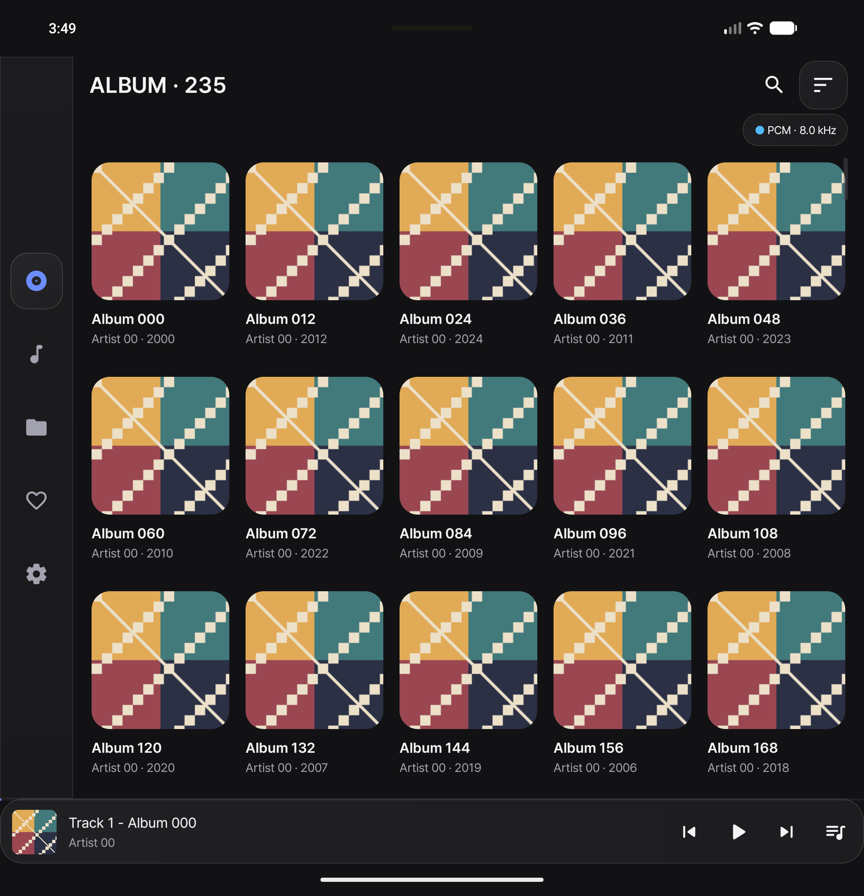
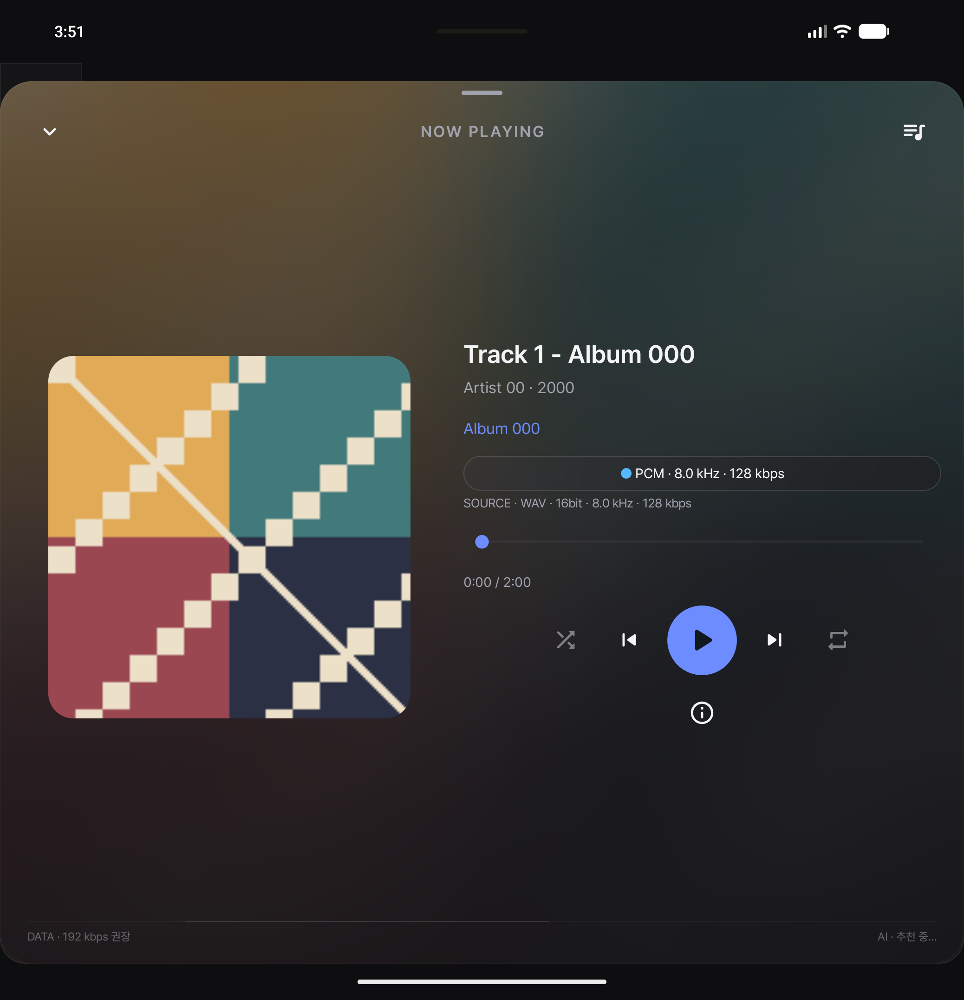

# NaviFold

Navidrome 음악을 휴대폰에서 듣기 위해 만든 Android 플레이어입니다.
앨범과 폴더 단위로 음악을 찾고, 폴드의 접힌 화면과 펼친 화면에 맞춰 사용할 수 있습니다.

Android 8.0 이상 · **NaviFold Next 0.9.0-dev**

다음 버전 개발 브랜치입니다. 기존 앱과 별도로 설치되며 로그인·설정도 분리됩니다.
기존 0.8.4는 [릴리스 페이지](https://github.com/AkimaraYouki/NavidromeFold/releases/tag/v0.8.4)에서 받을 수 있습니다.

<p>
  
  
</p>

*테스트용 앨범과 음원으로 촬영한 화면입니다.*

## 기능

- 앨범·곡·폴더 탐색, 검색과 정렬, 커버 크기 조절
- 곡 다중 선택, 다음에 재생, 큐 추가·삭제와 순서 변경
- 원본 / MP3 재생, 잠금화면과 알림 패널 컨트롤
- 취향과 장르를 반영한 자동 큐 보충, ChatGPT 추천 연동
- 추천 기준 확인, 곡별 더 듣기·덜 듣기, 한 번만 큐에서 제외
- 앱 재실행 시 큐와 마지막 위치 복원 — 일시정지 상태로 대기
- MusicBrainz 앨범 정보, AI 앨범 요약
- 데이터 사용량 확인·경고, 모바일 연결 시 음질 절약
- 자동 로그인, 음질 인디케이터, 다크·라이트 테마

## 빌드

Android Studio에서 프로젝트를 열면 됩니다. JDK 21과 Android SDK 35를 사용했습니다.

```bash
git clone https://github.com/AkimaraYouki/NavidromeFold.git
cd NavidromeFold
./gradlew assembleDebug
```

SDK를 찾지 못하면 `local.properties`에 `sdk.dir=/path/to/Android/Sdk`를 지정하세요.
APK는 `app/build/outputs/apk/debug/app-debug.apk`에 생성됩니다.

## 사용

설정의 **서버 · 계정**에 Navidrome 주소와 계정을 입력하세요. Tailscale도 사용할 수 있습니다. HTTP 연결은 debug/qa 빌드에서 지원하며 release는 HTTPS가 필요합니다.

앨범을 길게 누르면 큐에 추가됩니다. 곡을 길게 눌러 여러 곡을 선택할 수도 있습니다.
자동 보충은 큐 팝업의 **AI** 스위치로 켭니다. ChatGPT 연결 없이도 로컬 추천을 사용할 수 있습니다.
큐의 곡을 길게 누르거나 재생창의 작은 AI 상태를 누르면 추천 기준과 선호 메뉴가 열립니다.

ChatGPT 연동은 계정별 사용 가능 여부 확인이 필요합니다. 외부 추천·정보 조회에는 곡 메타데이터를 사용하며 음원 파일은 보내지 않습니다. 자세한 동작은 [AI 추천 문서](docs/AI-RECOMMENDATION.md)에 정리했습니다.

개발 중인 앱으로, 오프라인 다운로드와 가사는 아직 지원하지 않습니다.
[변경 이력](CHANGELOG.md) · [검증 기록](BUILD-STATUS.md) · [테스트 서버](tools/README.md)

## 라이선스

[GPL-3.0](LICENSE). UI는 [Sonixd](https://github.com/jeffvli/sonixd)를 참고했습니다.
폰트는 Pretendard를 사용하며, 자산별 출처는 [THIRD-PARTY-NOTICES.md](THIRD-PARTY-NOTICES.md)에 있습니다.
